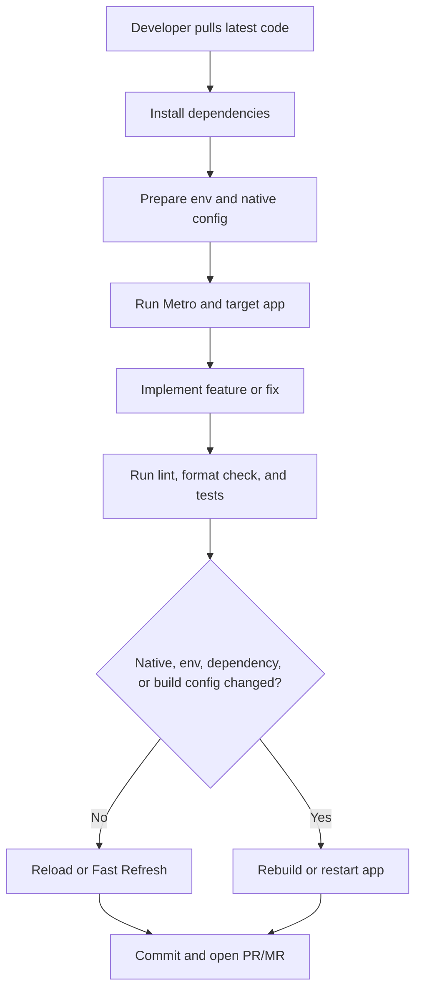
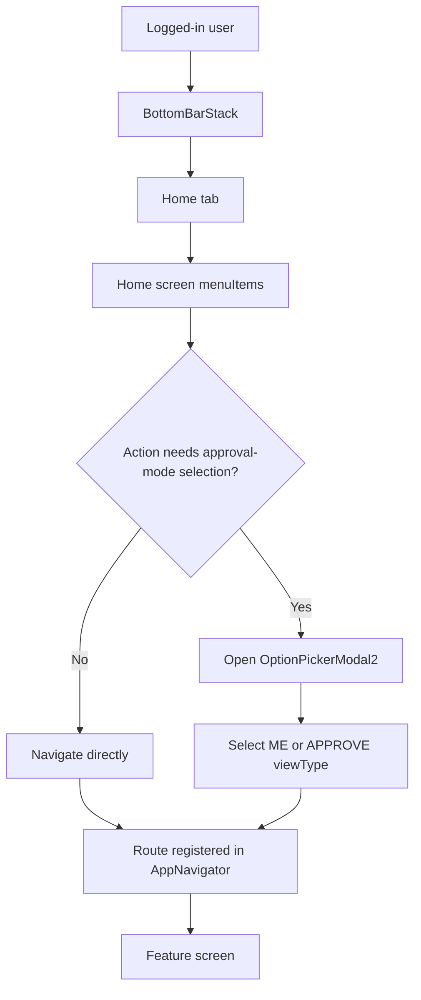
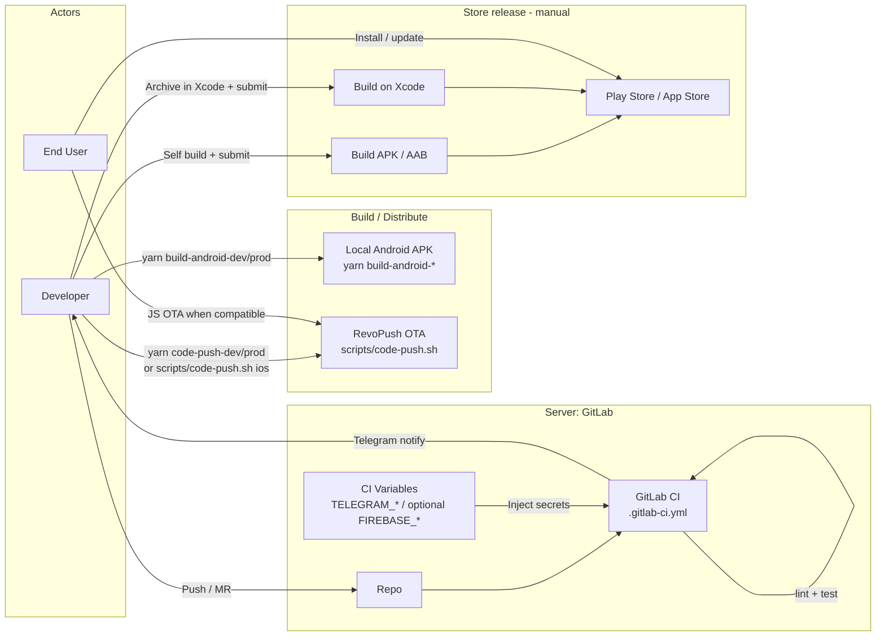
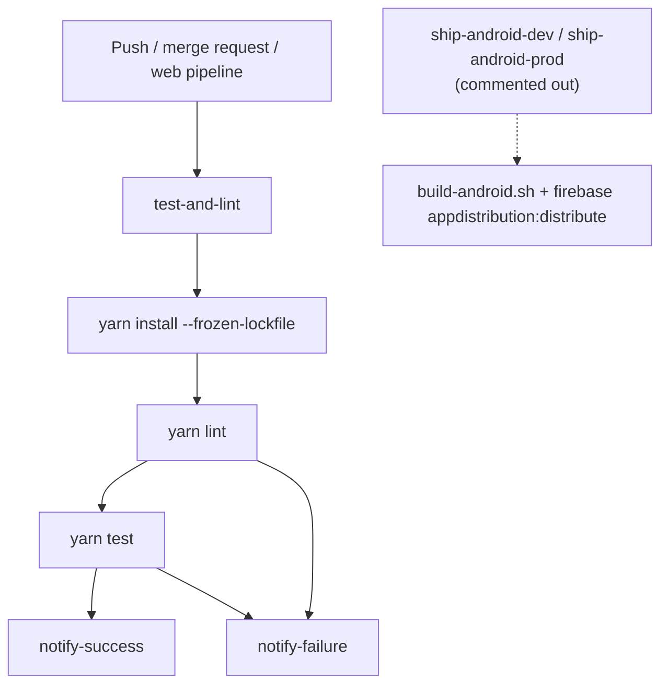

# ALP HRM

ALP HRM is a React Native CLI mobile HRM application built with React Native `0.77.3`, React `18`, TypeScript, Tamagui, React Navigation, SWR, Firebase Messaging/Remote Config, Notifee, and RevoPush CodePush. The app focuses on employee self-service and HR workflows such as profile lookup, timesheets, attendance explanations, leave registration, overtime, termination, discipline, insurance, tax, salary tickets, notifications, GPS tracking, suggestions, and company news.

The app entry path is `index.js` -> `App.tsx`. `App.tsx` composes the root providers: `SWRConfig`, `AppProvider`, `TamaguiProvider`, `PortalProvider`, `GestureHandlerRootView`, `BottomSheetModalProvider`, `MenuProvider`, `Host`, `AppNavigator`, `Toast`, and `ForceUpdateModal`.

## Projects And OS / Apps And Platforms

| Project/app name | Platform/OS | Native target/module | Bundle ID/Application ID | Notes |
| --- | --- | --- | --- | --- |
| ALP HRM | React Native JS | `App.tsx`, `src/`, registered by `app.json` name `ALP HRM` | N/A | Shared TypeScript source for Android and iOS. |
| ALP HRM | Android production release | Gradle module `android/app` | `com.vdx.alphrm` | App name `ALP HRM`; version is read from `.env`; Firebase and RevoPush are integrated. |
| ALP HRM Dbg | Android debug | `android/app` build type `debug` | `com.vdx.alphrm.debug` | `applicationIdSuffix ".debug"` and app name `ALP HRM Dbg`; used by `yarn run-android`. |
| ALP HRM Dev | Android development release | `android/app` build type `release` with `APP_ENV=development` | `com.vdx.alphrm.dev` | `applicationIdSuffix ".dev"`, `versionNameSuffix "-dev"`, and app name `ALP HRM Dev`; built by `yarn build-android-dev`. |
| ALPHRM | iOS app | `ios/ALPHRM.xcworkspace`, target/scheme `ALPHRM` | `com.vdx.alphrm` | iOS deployment target is `15.5`; React Native new architecture is disabled in `ios/Podfile`. |
| ALPHRMTests | iOS tests | `ios/ALPHRM.xcodeproj`, target `ALPHRMTests` | `com.vdx.alphrm` in current project settings | Native iOS test target. |

There are no separate web or backend projects in this repository.

## Setup

### Required Toolchain

- Node.js `>=18`.
- Yarn. `.yarnrc.yml` uses the `node-modules` linker.
- React Native CLI local environment for Android and iOS.
- Android Studio / Android SDK:
  - `compileSdkVersion 35`
  - `targetSdkVersion 35`
  - `minSdkVersion 24`
  - Android NDK `27.0.12077973`
  - Kotlin `1.9.22`
- Xcode and CocoaPods for iOS.
- Ruby/Bundler if you manage iOS dependencies through the included `Gemfile`.
- `revopush` CLI for CodePush release commands.

### Install Dependencies

```bash
yarn install
```

`postinstall` runs `patch-package`, so patches in `patches/` are applied automatically.

Install iOS Pods after dependency or native iOS changes:

```bash
cd ios
pod install
cd ..
```

### Environment Files

The project uses `react-native-dotenv` with `APP_ENV` as the environment selector. Keep base env files in the project root and put machine-specific or secret values in local override files.

| File | Purpose |
| --- | --- |
| `.env` | Base/development values. Android Gradle reads version values from this file. |
| `.env.local` | Optional local development overrides. |
| `.env.production` | Production values. |
| `.env.production.local` | Optional production overrides for local or CI builds. |

Env keys currently referenced by source code and scripts:

| Key | Used for |
| --- | --- |
| `ANDROID_VERSION_CODE`, `ANDROID_VERSION_NAME` | Android `versionCode`, `versionName`, RevoPush target version, and release description. |
| `IOS_VERSION_CODE`, `IOS_VERSION_NAME` | iOS build/version values and RevoPush target version. |
| `APP_BUNDLE_VERSION` | RevoPush release description. |
| `API_URL` | API base URL in `src/utils/client.ts` through `src/configs/env.ts`. |
| `HOST` | Shared host config. |
| `APP_NAME` | App name value exposed through env helpers. |
| `DB_NAME` | Secondary env helper value in `src/config/env.ts`. |
| `WS_URL` | WebSocket URL exposed by `src/configs/env.ts`. |
| `CODE_PUSH_ANDROID_DEPLOYMENT_KEY`, `CODE_PUSH_IOS_DEPLOYMENT_KEY` | RevoPush/CodePush deployment keys. |

Note: `src/configs/env.ts` imports `APP_NAME`, but `src/@types/env.d.ts` does not currently declare it. Add it there before relying on strict type coverage for env imports.

### Secret And Native Config Files

- Android Firebase: place `google-services.json` at `android/app/google-services.json`.
- iOS Firebase: this repo uses RNFirebase and the iOS target has the RNFB core build phase. If Firebase is enabled for iOS in your environment, add the matching `GoogleService-Info.plist` to the `ALPHRM` target.
- Android release signing currently uses `debug.keystore` for release builds in `android/app/build.gradle`. Configure a production keystore before any real store or production distribution release.

## App Folder Structure

### Root Project

| Path | Role |
| --- | --- |
| `App.tsx` | Main app component and provider composition. |
| `index.js` | React Native registry entry. |
| `app.json` | App name/display name: `ALP HRM`. |
| `package.json` | Dependencies and run/build/test scripts. |
| `src/` | Main TypeScript application source. |
| `android/` | Native Android project, Gradle config, Firebase plugin, RevoPush Gradle integration, resources, manifests. |
| `ios/` | Native iOS project/workspace for `ALPHRM`, Podfile, plist, assets, entitlements, and build phases. |
| `scripts/` | Local Android build/run helpers, iOS build script, and RevoPush release script. |
| `patches/` | `patch-package` patches applied after install. |
| `__tests__/` | Jest tests. Currently contains `App.test.tsx`. |
| `__mocks__/` | Jest mocks for Notifee, Firebase Messaging, geolocation, and Keychain. |
| `tamagui.config.ts` | Tamagui design/token config. |
| `babel.config.js` | Babel config, dotenv plugin, Reanimated plugin, and module aliases. |
| `metro.config.js` | Metro config for SVG transformer and extra asset extensions. |
| `jest.config.js`, `setup-jest.js` | Jest transform and mock setup. |
| `.gitlab-ci.yml` | GitLab CI lint/test pipeline and Telegram notifications. |

### Source Folders

| Path | Role |
| --- | --- |
| `src/assets/` | Static images and SVG icon components. SVGs are transformed through `react-native-svg-transformer`. |
| `src/components/` | Shared UI such as `Screen`, `Header`, `Toast`, `Table`, `SearchInput`, upload/viewer components, cards, dropdowns, and menus. |
| `src/components/base/` | Base primitives such as `Button`, `Input`, `Text`, `Modal`, `FlatList`, date/time pickers, option pickers, form helpers, and `Pressable`. |
| `src/configs/` | Current app config: env, navigation, storage, constants. |
| `src/config/` | Secondary env helper with `ENV` and `getEnv`. |
| `src/hooks/` | Shared hooks for API helpers, profile, storage, permissions, websocket, debounce, remote config, force update, and unauthorized handling. |
| `src/i18n/` | i18next setup with `en` and `vi` namespaces: `common`, `home`, `login`, `report`, `transfer`. |
| `src/modules/` | Feature modules and business screens. Most product code lives here. |
| `src/navigators/` | React Navigation setup, typed navigation utilities, bottom tabs, and app context provider. |
| `src/common/` | Shared enums, API/domain models, and styles. |
| `src/@types/`, `src/types/`, `custom.d.ts` | Project declarations, dotenv typings, and module declarations. |
| `src/@model/` | Small shared models such as `department` and `group`. |
| `src/utils/` | Shared API client, file viewer helper, scaling helpers, and general utilities. |

### Navigation

Navigation is centralized in:

- `src/navigators/AppNavigator.tsx`: creates the native stack, selects the initial route from `useAppContext().user`, and registers screens.
- `src/configs/navigation.ts`: defines `RouteName` and `AppStackParamList`.
- `src/navigators/BottomTabBar.tsx`: renders the custom bottom tab bar.

Initial route behavior:

| Condition | Initial route |
| --- | --- |
| `user?.employee_id` exists | `RouteName.BottomBarStack` |
| No logged-in user | `RouteName.Login` |

Bottom tabs:

| Tab | Route | Component |
| --- | --- | --- |
| Home | `RouteName.Home` | `modules/home/screens/Home` |
| Notification | `RouteName.Notification` | `modules/notification/screens/Notification` |
| User/Setting | `RouteName.Setting` | `modules/user/screens/User` |

### Module Structure

The codebase is feature-oriented, but modules are not perfectly uniform. Current modules commonly use this shape:

```text
src/modules/<feature>/
├── screens/ or <page-name>/
├── components/
├── hooks/
├── provider.tsx
├── <Feature>State.ts
├── data/
├── types/
└── utils/
```

For new modules, prefer this shape when it fits the feature:

```text
src/modules/<feature>/
├── screens/pages
├── components
├── hooks
├── services/api
├── configs/constants
└── types
```

In this repo, feature API work is usually implemented in feature hooks such as `useHomeApi`, `useNewsApi`, `useTaxApi`, `useTimeSheet`, and `useLeaveRegistrationApi`, using shared utilities and `src/utils/client.ts`.

### Existing Modules/Features

| Module | Main paths | Role |
| --- | --- | --- |
| `home` | `screens/Home.tsx`, `hooks/useHomeApi.ts`, `hooks/useNotificationCountApi.ts`, `components/HeaderHome.tsx` | Home dashboard, menu entry points, recent activities, notification count, FCM token saving, foreground notification display. |
| `user` | `screens/*`, `register/`, `hooks/*`, `components/*`, `types/`, `utils/credentials.ts` | Login, forgot password, profile, employee information, employee list, company/profile data, document list, company switch. |
| `notification` | `screens/Notification.tsx`, `hooks/useNotifications.ts`, `components/NotificationItem.tsx` | Notification list and item rendering. |
| `news` | `screens/News.tsx`, `screens/NewsDetail.tsx`, `hooks/useNewsApi.ts` | Company/news list and detail. |
| `timesheet` | `screens/*`, `hooks/*`, `state/`, `timesheet-filter/` | Timesheet, attendance explanations, attendance violations, and filters. |
| `leave-registration` | `list/`, `detail/`, `editor/`, `leave-report/` | Leave list/detail/editor and leave report flows. |
| `over-time` | `over-times/`, `over-time-editor/`, `over-time-detail/` | Overtime list, create/edit, and detail flows. |
| `termination` | `terminations/`, `termination-editor/`, `termination-detail/` | Termination/resignation list, editor, and detail flows. |
| `discipline` | `discipline-list/`, `discipline-detail/` | Discipline records list and detail. |
| `personal-report` | `personal-report-list/`, `personal-report-editor/` | Personal report list and editor. |
| `insurance` | `insurance-menu.tsx`, `insurance-detail/` | Insurance menu and detail views. |
| `tax` | `index.tsx`, `provider.tsx`, `hooks/useTaxApi.ts`, `components/TaxItem.tsx` | Tax screen and tax API hook. |
| `salary-ticket` | `salary-ticket-list/`, `salary-ticket-detail/` | Salary ticket list and detail. |
| `gps` | `gps-list/`, `gps-tracking/` | GPS list and tracking screens. |
| `suggestion` | `screens/Suggestion*.tsx`, `hooks/*`, `components/*` | Suggestions/feedback list, detail/editor, and upload helpers. |
| `comment` | `screens/CommentEditor.tsx`, `hooks/useCommentEditor.tsx` | Shared comment editor flow. |
| `menu` | `FullMenu.tsx`, `components/MenuItem.tsx` | Full menu and menu item rendering. |
| `vps` | `screens/Vps.tsx` | VPS feature screen. |

### Imports And Aliases

`tsconfig.json` sets `baseUrl` to `./src`, so imports like `components`, `hooks`, `utils`, and `configs/env` work from source files. Explicit aliases are also configured for:

- `home`
- `notification`
- `user`
- `vps`
- `news`
- `timesheet`
- `setting`

The `setting` alias exists in `babel.config.js` and `tsconfig.json`, but there is currently no `src/modules/setting` folder. When adding a new alias, update both `tsconfig.json` and `babel.config.js`.

## Development

Start Metro:

```bash
yarn start
```

Run Android debug:

```bash
yarn run-android
```

`yarn run-android` installs dependencies, loads `.env` and optional `.env.local`, then runs:

```bash
yarn android --no-packager --active-arch-only --appIdSuffix=debug
```

You can also use the raw React Native Android command:

```bash
yarn android
```

Run iOS simulator:

```bash
yarn ios
```

If Pods or native iOS dependencies changed:

```bash
cd ios
pod install
cd ..
```

Reload behavior:

| Change type | Usual action |
| --- | --- |
| JS/TS/UI only | Use Fast Refresh or reload the app. |
| Env values | Restart Metro; rebuild if the value is embedded in native build/version/config. |
| Android Gradle/manifest/Firebase/permissions/resources/native modules | Rebuild Android. |
| iOS Podfile/plist/entitlements/signing/assets/native modules | Run `pod install` when needed, then rebuild iOS. |
| Dependencies | Run `yarn install`; run `pod install` too when native iOS pods are affected. |

## Build And Update Commands

Commands from `package.json`:

| Command | What it does |
| --- | --- |
| `yarn start` | Starts Metro bundler with `react-native start`. |
| `yarn android` | Runs `react-native run-android`. |
| `yarn ios` | Runs `react-native run-ios`. |
| `yarn run-android` | Runs `scripts/run-android.sh` for Android debug with `.debug` app id suffix. |
| `yarn build-android-dev` | Runs `scripts/build-android.sh --development`; builds Android release with `.dev` id suffix. |
| `yarn build-android-prod` | Runs `scripts/build-android.sh --production`; builds Android production release. |
| `yarn code-push-dev` | Runs `scripts/code-push.sh android --development`. Current script does not parse this `--development` argument; it uses `APP_ENV` from env files or defaults to development. |
| `yarn code-push-prod` | Runs `scripts/code-push.sh android --production`. Current script does not parse this `--production` argument; it uses `APP_ENV` from env files. |
| `yarn lint` | Runs ESLint for JS/TS/TSX/JSON files. |
| `yarn format` | Runs ESLint fix for TS/TSX and Prettier write for `src/**/*.{ts,tsx}`. |
| `yarn format:check` | Runs Prettier check across the repo. |
| `yarn test` | Runs Jest. |
| `yarn postinstall` | Runs `patch-package`; normally invoked automatically after install. |

Shell script notes:

| Script | Notes |
| --- | --- |
| `scripts/run-android.sh` | Local Android debug runner. Loads `.env` and `.env.local`. |
| `scripts/build-android.sh --development` | Sets `APP_ENV=development`, loads development env files, exports `COMMIT_HASH`, removes `android/app/build`, then runs `yarn react-native build-android --tasks assembleRelease`. |
| `scripts/build-android.sh --production` | Sets `APP_ENV=production`, loads production env files, exports `COMMIT_HASH`, removes `android/app/build`, then builds release. |
| `scripts/code-push.sh android` | Releases Android bundle to RevoPush app `may10-qms`. This app name looks copied from another repo and should be corrected for ALP HRM before real releases. |
| `scripts/code-push.sh ios` | Contains an iOS RevoPush branch, also targeting app `may10-qms`. |
| `scripts/build-ios.sh` | Currently outdated: it references `PortalApp.xcworkspace`, scheme `PortalApp`, and `PortalApp.xcarchive`, while the actual project is `ALPHRM`. Fix this script before relying on it. |

Important mismatch from older documentation: `yarn code-push-production` does not exist. Use `yarn code-push-prod`.

## Development / Coding Flow

Use this flow for normal feature or bug work:

1. Pull the latest code from the target branch.
2. Run `yarn install` so dependencies and `patch-package` patches are applied.
3. Prepare env/config files:
   - ensure `.env` exists
   - create/update `.env.local` for local secrets
   - create/update `.env.production.local` only when building production locally or in CI
   - place `android/app/google-services.json` for Android Firebase
4. Start Metro with `yarn start`.
5. Run the target app:
   - Android debug: `yarn run-android`
   - iOS simulator: `yarn ios`
6. Implement the change inside the matching `src/modules/<feature>` folder when possible.
7. Update `src/configs/navigation.ts` and `src/navigators/AppNavigator.tsx` when adding screens.
8. Put shared UI in `src/components` or `src/components/base`; keep feature-only UI in the module's `components` folder.
9. Put shared models/enums in `src/common`; feature-only types can stay inside the module.
10. Keep feature-specific API/state hooks near the feature and reuse shared client/util patterns.
11. Use Fast Refresh/reload for JS/UI-only changes.
12. Rebuild/restart the app for native/config/env/dependency changes.
13. Run quality checks.
14. Commit and open a PR/MR with platform impact, env/config changes, and any required rebuild notes.



## How To Develop A Feature

The main user entry point after login is the Home tab:

- Home tab registration: `src/navigators/AppNavigator.tsx`
- Home screen/menu implementation: `src/modules/home/screens/Home.tsx`
- Route names and params: `src/configs/navigation.ts`
- Navigation helper: `src/navigators/navigationUtilities.ts`

`Home.tsx` defines `menuItems` with menu labels, icons, and `onPress` handlers. Some actions navigate directly, while others open `OptionPickerModal2` first based on approval flags from `useUser()`.

Current Home menu flow:



Checklist for adding a Home-driven feature:

1. Add the route name and route params to `src/configs/navigation.ts`.
2. Create the screen/page in the owning feature module under `src/modules/<feature>`.
3. Export the screen if the module uses a `screens/index.ts` barrel.
4. Import and register the screen in `src/navigators/AppNavigator.tsx`.
5. Add a new `menuItems` entry in `src/modules/home/screens/Home.tsx`, or add an option handler/modal path if the feature needs mode selection.
6. Put feature-only UI in `src/modules/<feature>/components`; put reusable UI in `src/components` or `src/components/base`.
7. Put feature-specific API/state logic in a module hook/provider/state file; use `src/utils/client.ts` and shared hooks where appropriate.
8. Add or update translations in both `src/i18n/en/*.json` and `src/i18n/vi/*.json` if the screen has user-facing text.
9. Check approval flags, role values, or feature access fields near the existing Home logic if visibility or routing depends on user permissions.
10. Test direct navigation, option modal selection, route params, back navigation, loading, empty state, error state, and any create/update callbacks.

Example: add a new employee document route from Home.

```ts
// src/configs/navigation.ts
export enum RouteName {
  // ...
  EmployeeDocuments = 'EmployeeDocuments',
}

type ParamList = Record<RouteName | string, any> & {
  // ...
  [RouteName.EmployeeDocuments]: {
    employeeId?: number;
  };
};
```

```tsx
// src/modules/user/screens/EmployeeDocuments.tsx
import React from 'react';
import { Text } from 'components';
import { RouteName } from 'configs/navigation';
import { AppStackScreenProps } from 'navigators/AppNavigator';

type Props = AppStackScreenProps<RouteName.EmployeeDocuments>;

const EmployeeDocuments = ({ route }: Props) => {
  return <Text>{`Employee: ${route.params?.employeeId ?? 'current'}`}</Text>;
};

export default EmployeeDocuments;
```

```ts
// src/modules/user/screens/index.ts
export { default as EmployeeDocuments } from './EmployeeDocuments';
```

```tsx
// src/navigators/AppNavigator.tsx
import { EmployeeDocuments } from 'modules/user/screens';

// inside Stack.Navigator
<Stack.Screen name={RouteName.EmployeeDocuments} component={EmployeeDocuments} />;
```

```tsx
// src/modules/home/screens/Home.tsx
const menuItems = useMemo(
  () => [
    // ...
    {
      key: 'employee_documents',
      label: 'Documents',
      icon: Images.tai_lieu,
      onPress: () => {
        navigate(RouteName.EmployeeDocuments, {
          employeeId: user?.employee_id,
        });
      },
    },
  ],
  [user?.employee_id],
);
```

Responsibility rules:

- Entry points such as `Home.tsx` coordinate menu actions, approval-mode selection, and navigation.
- Parent list screens decide which detail/editor screen to open.
- Hooks/providers handle data fetching, mutation, normalization, loading, and errors.
- Components render UI and emit events upward.
- Route params should stay explicit and narrow, such as `id`, `employeeId`, `viewType`, `date`, or callbacks already used by existing flows.

## Deploy Pipeline / CI/CD Flow

ALP HRM is a React Native CLI app (not Expo/EAS). GitLab CI runs lint and unit tests, then posts Telegram notifications. Native binaries are built locally (`scripts/build-android.sh`, Xcode for iOS). JS/asset OTA updates go to RevoPush via `scripts/code-push.sh`. Play Store / App Store submission is manual. Commented Firebase App Distribution ship jobs exist in `.gitlab-ci.yml` but are not active.

### Architecture Overview



| Actor / system | Role |
| --- | --- |
| Developer | Pushes code; runs local Android/iOS builds; releases RevoPush OTA; submits store binaries manually. |
| End User | Installs from Play Store / App Store, or receives compatible JS updates via RevoPush. |
| GitLab Repo | Source of truth for the React Native CLI codebase. |
| GitLab CI | Runs `yarn lint` and `yarn test`; sends Telegram success/failure messages. Does not build or submit store binaries today. |
| GitLab CI Variables | Injects secrets into CI (`TELEGRAM_TOKEN`, `TELEGRAM_CHAT_ID`; ship jobs would also need Firebase/Google Services vars when enabled). |
| Local Android build | `scripts/build-android.sh` produces a release APK under `android/app/build/outputs/apk/release/`. |
| RevoPush | OTA channel used by `@revopush/react-native-code-push` and `revopush release-react`. |
| Xcode / Play Store / App Store | Manual archive and store upload; not wired in CI. |

### End-to-End Pipeline Stages

Defined stages in `.gitlab-ci.yml`: `test` → `ship` → `notify`. Only `test` and `notify` jobs are active. `ship` Android Firebase App Distribution jobs are commented out.



### Recommended Triggers

| Event / source | What runs |
| --- | --- |
| `push` | `test-and-lint` → Telegram notify |
| `merge_request_event` | `test-and-lint` → Telegram notify |
| `web` (manual pipeline) | `test-and-lint` → Telegram notify |
| Local developer machine | Android APK via `yarn build-android-*`; RevoPush via `yarn code-push-*` / `scripts/code-push.sh`; iOS archive via Xcode |
| Commented `ship-*` jobs | Would be `when: manual` Firebase App Distribution if uncommented |

### Native Build vs OTA

| Change type | Path |
| --- | --- |
| JS/TS, assets, styles compatible with the installed native binary | RevoPush OTA (`yarn code-push-dev` / `yarn code-push-prod`, or `scripts/code-push.sh ios`) |
| Native modules, permissions, Firebase config, bundle IDs, Gradle/Podfile, signing, app version behavior, native resources | New native binary: Android `yarn build-android-*`, iOS archive in Xcode |
| First install or store version bump | Manual Play Store / App Store release |

Only use RevoPush for JavaScript/asset changes that remain compatible with the already installed native runtime. Before real ALP HRM OTA releases, fix `scripts/code-push.sh`: it currently targets RevoPush app name `may10-qms`.

### Local Build / Update Commands

| Command | What it does |
| --- | --- |
| `yarn build-android-dev` | `scripts/build-android.sh --development` → release APK with `.dev` application id suffix |
| `yarn build-android-prod` | `scripts/build-android.sh --production` → production release APK |
| `yarn code-push-dev` | `scripts/code-push.sh android --development` (script reads `APP_ENV` from env files; does not parse the CLI flag) |
| `yarn code-push-prod` | `scripts/code-push.sh android --production` (same: uses `APP_ENV` from env files) |
| `scripts/code-push.sh ios` | iOS RevoPush release branch (no package.json alias) |
| Xcode archive | `ios/ALPHRM.xcworkspace`, scheme/target `ALPHRM`, bundle id `com.vdx.alphrm` |

Android env ↔ application id:

| Environment | Command | Application ID | App name |
| --- | --- | --- | --- |
| Debug local | `yarn run-android` | `com.vdx.alphrm.debug` | `ALP HRM Dbg` |
| Development release | `yarn build-android-dev` | `com.vdx.alphrm.dev` | `ALP HRM Dev` |
| Production release | `yarn build-android-prod` | `com.vdx.alphrm` | `ALP HRM` |

### GitLab CI Pipeline

Primary file: `.gitlab-ci.yml`. Runner tag: `test-runner`. Active job image: `node:20`.

Active jobs:

| Job | Stage | Behavior |
| --- | --- | --- |
| `test-and-lint` | `test` | `yarn install --frozen-lockfile`, `yarn lint`, `yarn test` |
| `notify-success` | `notify` | Telegram message when pipeline succeeds (`when: on_success`) |
| `notify-failure` | `notify` | Telegram message when pipeline fails (`when: on_failure`) |

Commented (inactive) ship jobs would use image `reactnativecommunity/react-native-android:latest`, copy `$GOOGLE_SERVICES_JSON` into `android/app/google-services.json`, build with `scripts/build-android.sh`, and distribute the APK via `firebase appdistribution:distribute`.

GitLab CI Variables / Secrets referenced by `.gitlab-ci.yml`:

| Variable | Used by | Status |
| --- | --- | --- |
| `TELEGRAM_TOKEN` | `notify-success`, `notify-failure` | Active |
| `TELEGRAM_CHAT_ID` | `notify-success`, `notify-failure` | Active |
| `TARGET_ENV` | Optional label in Telegram message (`Push/MR Mode` fallback) | Active if set |
| `GOOGLE_SERVICES_JSON` | Commented `ship_*` before_script | Inactive until ship jobs are enabled |
| `FIREBASE_TOKEN` | Commented Firebase App Distribution | Inactive until ship jobs are enabled |
| `FIREBASE_ANDROID_DEV_APP_ID` | Commented `ship-android-dev` | Inactive until ship jobs are enabled |
| `FIREBASE_ANDROID_PROD_APP_ID` | Commented `ship-android-prod` | Inactive until ship jobs are enabled |

Secrets come from GitLab CI/CD Variables. There is no Vault, Teleport, or EAS configuration in this repository.

### Store Release (manual)

CI does not submit to Play Store or App Store.

**Android**

1. Configure a production keystore before real store distribution (release currently uses `debug.keystore` in `android/app/build.gradle`).
2. Run `yarn build-android-prod` (or build an AAB locally if required by Play Console).
3. Take the artifact from `android/app/build/outputs/apk/release/` (or your AAB output path).
4. Upload manually in Google Play Console.

**iOS**

1. Open `ios/ALPHRM.xcworkspace` in Xcode.
2. Select scheme `ALPHRM`, archive a Release build.
3. Distribute / upload to App Store Connect from Xcode (or Transporter).
4. Do not use `scripts/build-ios.sh` until it is fixed (see notes below).

### iOS / Android Notes

- `scripts/build-ios.sh` is outdated: it references `PortalApp.xcworkspace`, scheme `PortalApp`, and `PortalApp.xcarchive`. The real project is `ALPHRM`. Fix or avoid this script.
- `scripts/code-push.sh` releases to RevoPush app `may10-qms` for both Android and iOS. Correct the app name before production OTA.
- `yarn code-push-dev` / `yarn code-push-prod` pass `--development` / `--production`, but `scripts/code-push.sh` does not parse those flags; set `APP_ENV` via `.env` / `.env.production` (and optional `*.local` overrides).
- There is no Expo / `eas.json` in this repo. OTA is RevoPush only.

## Quality Gates

Run these before merging:

```bash
yarn lint
yarn format:check
yarn test
```

Recommended extra gates when the change touches typed contracts or native/build behavior:

```bash
npx tsc --noEmit
yarn build-android-dev
```

`npx tsc --noEmit` and the Android build smoke test are recommendations because they are not currently required package scripts or active CI jobs.

## Notes For New Developers

- Keep route names and route params typed in `src/configs/navigation.ts`.
- `AppProvider` and `useAppContext` drive login state and initial navigation.
- `src/configs/env.ts` is the env helper used by the API client. `src/config/env.ts` also exists as a smaller secondary helper.
- The project uses Hermes and has React Native new architecture disabled.
- Android app version is read by Gradle from `.env`; iOS has a build phase named `Update Version from .env`.
- Avoid committing local secrets. Use `.env.local` and `.env.production.local` for machine-specific or CI-specific overrides.
