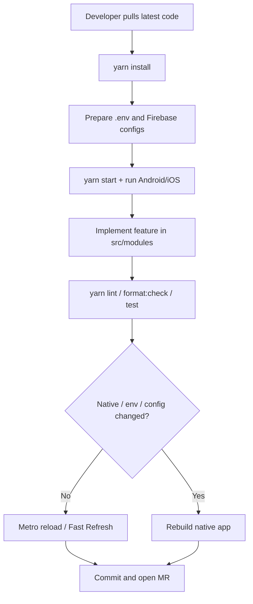
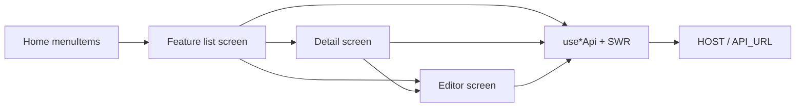
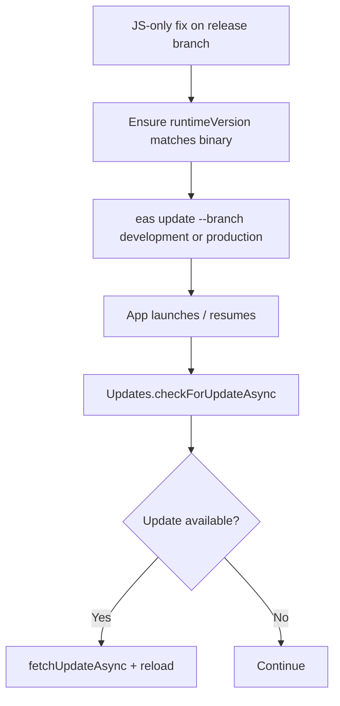
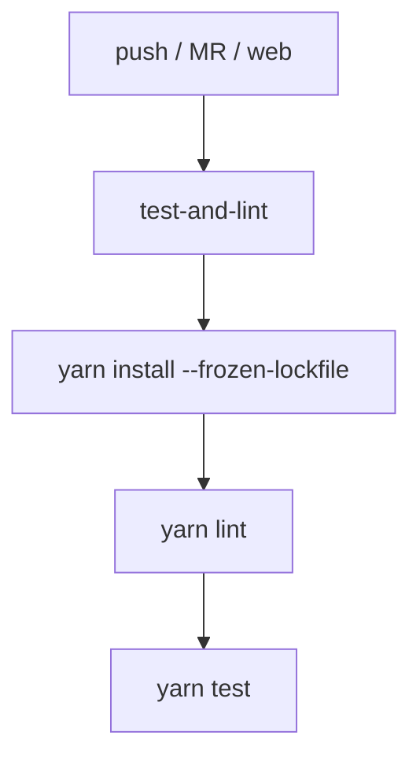
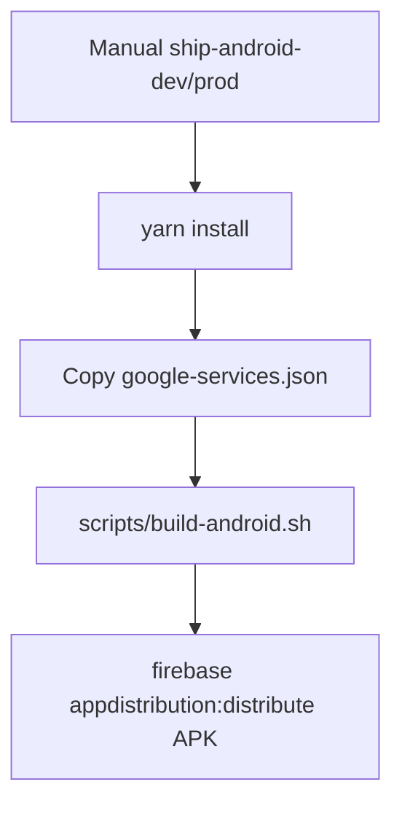

# ALP HRM

Mobile HRM app for An Loc Phat, built with **React Native 0.79**, **Expo Modules** (`expo-updates`, `expo-asset`), **Tamagui**, **React Navigation**, and **SWR**. Package name in `package.json` is `alphrm`; display name is **ALP HRM**.

Primary use cases: employee self-service (profile, timesheet, leave, payroll, insurance, resignation), approver flows, documents, and digital signature.

## Projects And OS / Apps And Platforms

| Project / App | Platform | Native target | Bundle / Application ID | Notes |
|---------------|----------|---------------|-------------------------|-------|
| ALP HRM | Android | `android/` (`com.vdx.alphrm`) | `com.vdx.alphrm` | Release + `APP_ENV=production` |
| ALP HRM Dev | Android | same | `com.vdx.alphrm.dev` | Release + `APP_ENV=development` (`applicationIdSuffix ".dev"`) |
| ALP HRM Dbg | Android | same | `com.vdx.alphrm.debug` | Debug build (`applicationIdSuffix ".debug"`) |
| ALP HRM | iOS | `ios/ALPHRM.xcworkspace` / scheme `ALPHRM` | `com.vdx.alphrm` | CocoaPods + Firebase |

Env / OTA channels:

| Env | How it is selected | EAS Update branch / channel |
|-----|--------------------|-----------------------------|
| Development | `APP_ENV=development` (default local `.env`) | `development` |
| Production | `APP_ENV=production` + `.env.production` | `production` |

Expo project slug: `anlocphat-hrm` (`app.config.js`).

## Setup

### Prerequisites

- Node.js `>= 18` (CI uses Node 20)
- Yarn (Berry config present via `.yarnrc.yml`; install with project lockfile)
- Xcode + CocoaPods (iOS)
- Android Studio / SDK / NDK (Android)
- Ruby + Bundler for CocoaPods (`Gemfile`)
- EAS CLI (for OTA updates): `npm i -g eas-cli` (optional for local run)

### Install dependencies

```bash
yarn install
# postinstall runs patch-package automatically

cd ios && pod install && cd ..
```

### Environment files

Create / keep these at repo root (do **not** commit secrets in `*.local`):

| File | Purpose |
|------|---------|
| `.env` | Default / development values |
| `.env.local` | Local overrides (gitignored) |
| `.env.production` | Production values |
| `.env.production.local` | Production local overrides (gitignored) |

Variables used by the app / build (names only):

- `ANDROID_VERSION_NAME`, `ANDROID_VERSION_CODE`
- `IOS_VERSION_NAME`, `IOS_VERSION_CODE`, `APP_BUNDLE_VERSION`
- `HOST`, `API_URL`, `DB_NAME`
- `CODE_PUSH_IOS_DEPLOYMENT_KEY`, `CODE_PUSH_ANDROID_DEPLOYMENT_KEY` (legacy; primary OTA is EAS Update)

`react-native-dotenv` loads env via Babel (`envName: APP_ENV`). Set `APP_ENV=production` to prefer production env files.

Typed access lives in `src/config/env.ts` and `src/configs/env.ts` (import from `react-native-dotenv`).

### Native secrets / config (gitignored)

Place these before building or shipping:

| File | Location |
|------|----------|
| `google-services.json` | `android/app/google-services.json` |
| `GoogleService-Info.plist` | iOS app target (pattern `GoogleService-Info*.plist` is gitignored) |
| Release keystore | Android signing (do not commit `*.keystore` except `debug.keystore`) |

CI copies `google-services.json` from `$GOOGLE_SERVICES_JSON` in ship jobs (currently commented in `.gitlab-ci.yml`).

## App Folder Structure

### Root

```text
mobile-hrm-alp/
├── android/           # Native Android project
├── ios/               # Native iOS project (ALPHRM)
├── src/               # Application source
├── scripts/           # run/build helpers
├── patches/           # patch-package patches
├── __mocks__/         # Jest mocks
├── __tests__/         # Tests
├── App.tsx            # Providers, OTA check, navigator
├── index.js           # AppRegistry entry
├── app.config.js      # Expo / EAS Update config
├── eas.json           # EAS build profiles & channels
├── tamagui.config.ts  # UI theme tokens
└── .gitlab-ci.yml     # lint/test (+ optional ship/notify)
```

### `src/`

| Folder | Role |
|--------|------|
| `modules/` | Feature modules (screens, hooks, providers) |
| `navigators/` | Root stack, bottom tabs, `AppProvider`, navigation helpers |
| `components/` | Shared UI (`Header`, `Screen`, forms, modals, …) |
| `hooks/` | Shared hooks + API singleton (`hooks/api.ts`) |
| `configs/` | Routes (`navigation.ts`), constants, storage |
| `config/` | Env helper |
| `i18n/` | `en` / `vi` translation JSON |
| `common/` | Shared enums and models |
| `utils/` | HTTP client, scaling, file helpers |
| `assets/` | Images and SVG icon components |
| `@types/`, `types/` | TypeScript declarations |
| `@model/` | Shared model helpers |

### Feature module layout

Most features follow list / detail / editor folders:

```text
src/modules/<feature>/
├── list/                 # or <feature>-list/
│   ├── index.tsx         # Screen + Provider wrapper
│   ├── provider.tsx
│   ├── *State.ts
│   ├── hooks/use*Api.ts  # SWR + api.POST
│   └── components/
├── detail/
├── editor/
└── …
```

### Modules

| Module | Role |
|--------|------|
| `home` | Home dashboard, feature menu, FCM registration |
| `user` | Login, register, forgot password, profile / employee info |
| `notification` | Notifications tab |
| `menu` | Full menu screen (`FullMenu`) |
| `leave-registration` | Leave list, detail, editor, leave report |
| `timesheet` | Timesheet, explanations, attendance violations |
| `termination` | Resignation letters |
| `over-time` | Overtime requests |
| `discipline` | Rewards / discipline |
| `personal-report` | Staff transfer / HCNS reports |
| `insurance` | Insurance menu + detail |
| `tax` | Personal income tax |
| `salary-ticket` | Payslip list + detail |
| `gps` | GPS list + tracking |
| `suggestion` | Suggestions / feedback |
| `comment` | Shared comment editor |
| `document` | Document list + PDF viewer |
| `digital-signature` | Sign request list, attachments, WebView signer |
| `news` | News list + detail |
| `vps` | VPS WebView screen |

## Development

### Start Metro

```bash
yarn start
```

### Run apps

```bash
# Android (debug, applicationIdSuffix=debug)
yarn run-android
# or: yarn android

# iOS
yarn ios
```

`yarn run-android` runs `scripts/run-android.sh` (loads `.env` / `.env.local`, then `react-native run-android` with `--appIdSuffix=debug`).

### Hot reload vs rebuild

| Change type | Action |
|-------------|--------|
| JS / TS / UI under `src/` | Metro Fast Refresh / reload |
| Env vars (`.env*`), Babel, native deps, `android/` / `ios/` | Rebuild native app |
| Pods / Gradle / Firebase plist | Reinstall pods / clean build |

## Build And Update Commands

| Command | Description |
|---------|-------------|
| `yarn android` | Run Android via RN CLI |
| `yarn ios` | Run iOS via RN CLI |
| `yarn start` | Start Metro |
| `yarn lint` | ESLint |
| `yarn format` | ESLint `--fix` + Prettier write on `src/**/*.{ts,tsx}` |
| `yarn format:check` | Prettier check |
| `yarn test` | Jest |
| `yarn run-android` | `./scripts/run-android.sh` |
| `yarn build-android-dev` | `./scripts/build-android.sh --development` → `assembleRelease` |
| `yarn build-android-prod` | `./scripts/build-android.sh --production` → `assembleRelease` |
| `yarn update-android-dev` | `eas update --branch development --platform android` |
| `yarn update-android-prod` | `eas update --branch production --platform android` |
| `yarn update-ios-dev` | `eas update --branch development --platform ios` |
| `yarn update-ios-prod` | `eas update --branch production --platform ios` |

### Script notes (mismatches)

- `scripts/build-ios.sh` still references `PortalApp.xcworkspace` / scheme `PortalApp`. Current native project is `ALPHRM` — **do not use this script as-is** until it is updated.
- `scripts/code-push.sh` targets legacy RevoPush (`revopush release-react …`). Prefer EAS Update scripts above for JS OTA.
- GitLab `ship-android-*` and Telegram notify jobs in `.gitlab-ci.yml` are currently **commented out**. Active CI stage is `test-and-lint` (`yarn lint` + `yarn test`).

## Development / Coding Flow

1. Pull latest code.
2. `yarn install` (and `pod install` on iOS when native deps change).
3. Ensure `.env` / `.env.local` and Firebase config files are in place.
4. `yarn start` + `yarn run-android` or `yarn ios`.
5. Implement feature under `src/modules/<feature>/`.
6. Reload for JS/UI changes; rebuild for native/env/config.
7. Run `yarn lint`, `yarn format:check`, `yarn test`.
8. Commit and open MR/PR.



## How to develop a feature

Entry point for most HR features is the Home menu.

### 1. Entry point

- File: `src/modules/home/screens/Home.tsx`
- Menu items are the `menuItems` array (`key`, `label`, `icon`, `onPress`).
- Navigation helper: `navigate` from `navigators`.
- Approver options use bottom sheets (`OptionPickerModal2`) when `userApprovalInfor` flags allow.

Example — leave registration entry:

```tsx
{
  key: 'dang_ky_nghi',
  label: 'Đăng ký nghỉ',
  icon: Images.dang_ky_nghi,
  onPress: () => {
    if (userApprovalInfor?.approve_hr_leave) {
      sheetLeaveRef.current?.present();
    } else {
      navigate(RouteName.LeaveRegistrations, { viewType: LeaveRegistrationViewType.ME });
    }
  },
}
```

### 2. Add a new Home action

Edit `menuItems` in `src/modules/home/screens/Home.tsx`. Add icon under `src/assets` if needed.

### 3. Add a child screen

Create under the feature module, for example:

```text
src/modules/leave-registration/list/index.tsx
src/modules/leave-registration/detail/index.tsx
src/modules/leave-registration/editor/index.tsx
```

### 4. Register the route

1. Add enum + params in `src/configs/navigation.ts`:

```ts
export enum RouteName {
  // …
  LeaveRegistrations = 'LeaveRegistrations',
  LeaveRegistrationsDetail = 'LeaveRegistrationsDetail',
  LeaveRegistrationEditor = 'LeaveRegistrationEditor',
}

// AppStackParamList params:
LeaveRegistrations: {
  viewType?: LeaveRegistrationViewType;
};
[RouteName.LeaveRegistrationsDetail]: {
  id?: number;
  viewType?: LeaveRegistrationViewType;
};
```

2. Wire the screen in `src/navigators/AppNavigator.tsx`:

```tsx
<Stack.Screen name={RouteName.LeaveRegistrations} component={LeaveRegistrationsPage} />
<Stack.Screen
  name={RouteName.LeaveRegistrationsDetail}
  component={LeaveRegistrationDetailPage}
/>
```

### 5. Navigate list → detail

From list item (pattern in leave-registration list):

```tsx
navigate(RouteName.LeaveRegistrationsDetail, {
  id: item.id,
  viewType: provider.viewType,
});
```

### 6. API / state

Typical pattern:

| Layer | Location |
|-------|----------|
| UI / filter state | `*State.ts` |
| Data fetching | `hooks/use*Api.ts` with SWR + `api` from `hooks/api.ts` |
| Context glue | `provider.tsx` |
| Screen | `index.tsx` wraps page in Provider |

HTTP base URL comes from `env.apiUrl` via `src/utils/client.ts`.

### 7. Shared vs module components

| Place | When |
|-------|------|
| `src/components/` / `src/components/base/` | Reusable across features |
| `src/modules/<feature>/**/components/` | Feature-only UI |

### 8. i18n

- Resources: `src/i18n/en/*.json`, `src/i18n/vi/*.json`
- Wired in `src/i18n/index.ts`; init in `src/navigators/AppProvider.tsx`
- Default language: `vi` (`DEFAULT_LANGUAGE` in `src/configs/contansts.tsx`)
- Note: many Home labels are still hardcoded Vietnamese

### 9. Permissions / feature flags

| Mechanism | Where | Usage |
|-----------|-------|--------|
| Approver flags | `useUser()` → `userApprovalInfor` | Home sheets (leave / timesheet / resignation) |
| Staff transfer | `user.access_staff_transfer` | Discipline / personal-report visibility |
| Firebase Remote Config | `hooks/useRemoteConfig.ts` key `show_hidden_features` | Login / User hidden UI |
| `usePermissions` | `hooks/usePermissions.ts` | Exported helpers; not widely used by screens yet |

### 10. Post-change checklist

- [ ] Menu / entry navigates to the correct screen
- [ ] Route params typed in `AppStackParamList`
- [ ] List → detail → editor flow works for ME and APPROVE when applicable
- [ ] API errors and empty states handled
- [ ] i18n keys added if using `t(...)`
- [ ] `yarn lint` and `yarn test` pass

### Layering rules

- **Home / entry** only coordinates navigation and sheets.
- **Parent screen** decides which detail/editor to open and which params to pass.
- **Hooks / providers** own data and mutations.
- **Components** render UI and emit events upward.



## Deploy Pipeline

### Local / manual Android release

```bash
yarn build-android-dev   # APP_ENV=development → APK under android/app/build/outputs/
yarn build-android-prod  # APP_ENV=production
```

`scripts/build-android.sh` sources env files, cleans `android/app/build`, then runs `yarn react-native build-android --tasks assembleRelease`.

### OTA (EAS Update)

After a store/native binary that embeds the matching `runtimeVersion` (`ANDROID_VERSION_NAME` / `IOS_VERSION_NAME` in `app.config.js`):

```bash
yarn update-android-dev
yarn update-android-prod
yarn update-ios-dev
yarn update-ios-prod
```

Runtime OTA check runs in `App.tsx` via `expo-updates` (`checkForUpdateAsync` → `fetchUpdateAsync` → reload).



### GitLab CI (current)

Active pipeline (`.gitlab-ci.yml`):



Commented (not active) ship flow intended for Firebase App Distribution:



Telegram notify jobs are also commented out.

### EAS build profiles (`eas.json`)

| Profile | Notes |
|---------|-------|
| `development` | `developmentClient: true`, channel `development` |
| `preview` | Internal distribution, channel `preview` |
| `production` | Channel `production` |

## Quality Gates

Run before merge:

```bash
yarn lint
yarn format:check
yarn test
```

CI (`test-and-lint`) runs `yarn lint` and `yarn test` on push, merge request, and web pipelines.

There is **no** dedicated `typecheck` script in `package.json`. TypeScript is configured via `tsconfig.json`; run `npx tsc --noEmit` locally if you need a type gate (suggested, not a package script).

Optional smoke: install and open the debug Android build (`yarn run-android`) or a release APK from `build-android-*` and verify login + Home menu navigation.
