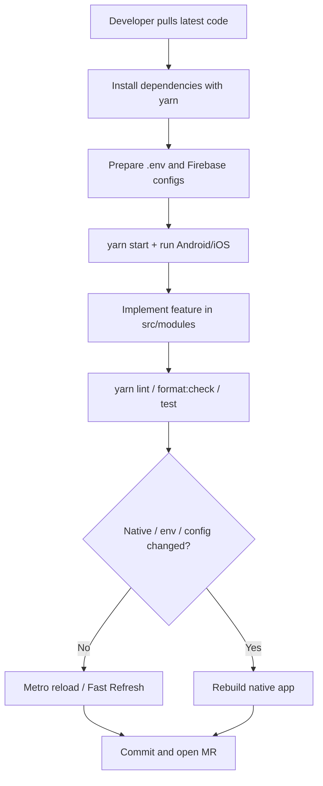
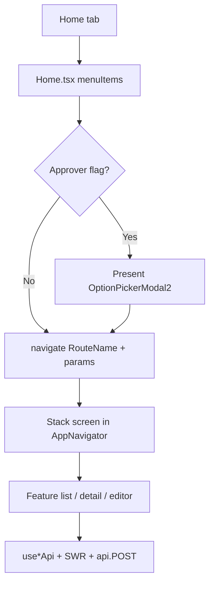
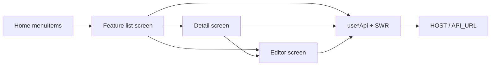
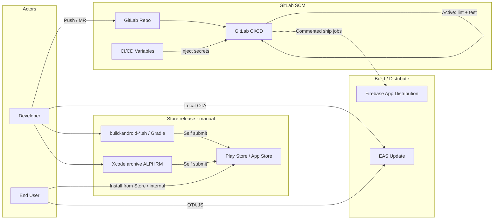
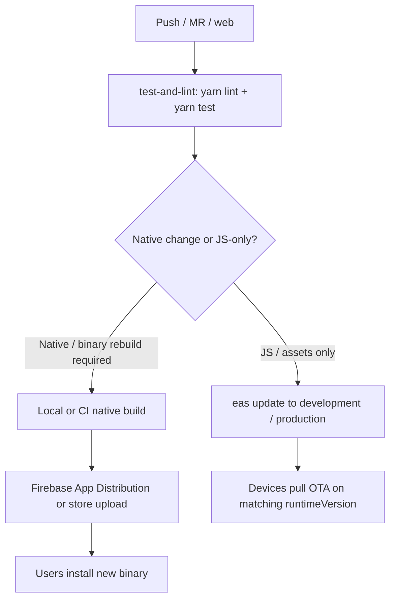
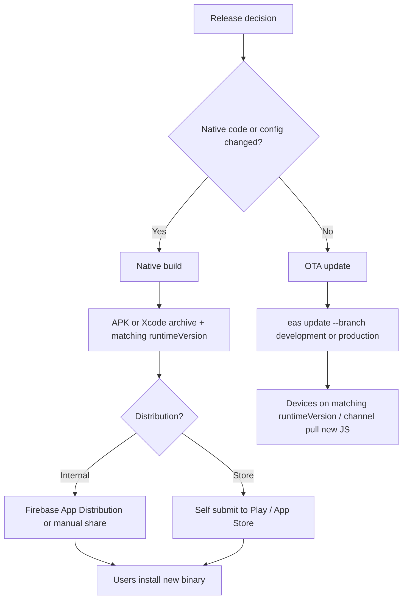
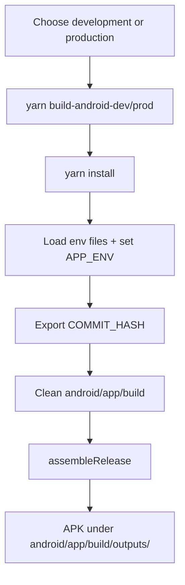
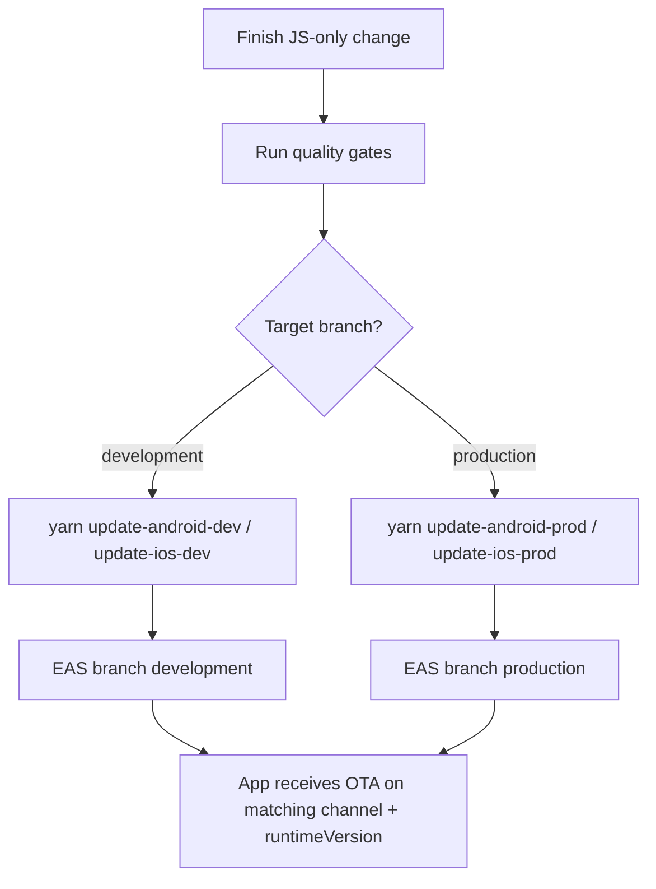
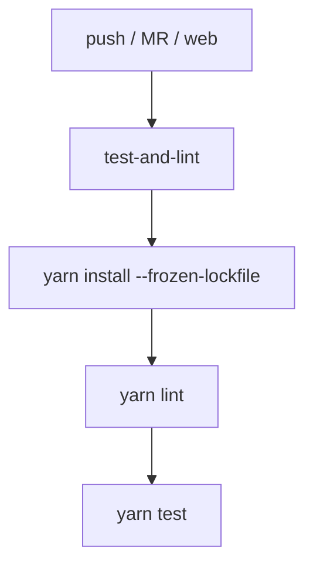
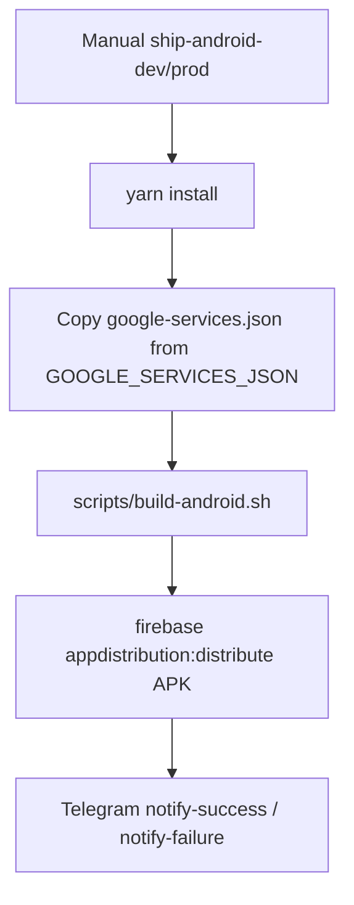

# ALP HRM

ALP HRM (package name `alphrm`) is a React Native HRM mobile app for An Loc Phat on Android and iOS. The stack is React Native `0.79`, Expo Modules (`expo-updates`, `expo-asset`), React Navigation, Tamagui, SWR, Firebase (Messaging / Remote Config), Notifee, i18next (`vi` / `en`), and MMKV + Keychain for persistence.

Primary domains: employee self-service (profile, timesheet, leave, payroll, insurance, resignation), approver flows, documents, and digital signature.

## Projects And OS / Apps And Platforms

| Project/app name | Platform/OS | Native target or module | Bundle ID/Application ID | Notes |
| ---------------- | ----------- | ----------------------- | ------------------------ | ----- |
| ALP HRM | Android | `android/app` (`com.vdx.alphrm`) | `com.vdx.alphrm` | Production release (`APP_ENV` not `development`). App name `ALP HRM`. Updates channel `production`. |
| ALP HRM Dev | Android | same | `com.vdx.alphrm.dev` | Release + `APP_ENV=development` (`applicationIdSuffix ".dev"`). App name `ALP HRM Dev`. Channel `development`. |
| ALP HRM Dbg | Android | same | `com.vdx.alphrm.debug` | Debug build (`applicationIdSuffix ".debug"`). App name `ALP HRM Dbg`. |
| ALP HRM Dbg | iOS | scheme `ALPHRM-Debug` / config `Debug` | `com.vdx.alphrm.debug` | Local Metro. Name `ALP HRM Dbg`. Channel `development`. |
| ALP HRM Dev | iOS | scheme `ALPHRM-Dev` / config `ReleaseDev` | `com.vdx.alphrm.dev` | Internal release. Name `ALP HRM Dev`. Channel `development`. |
| ALP HRM | iOS | scheme `ALPHRM` / config `Release` | `com.vdx.alphrm` | Store / production. Name `ALP HRM`. Channel `production`. |
| Expo Updates | Android/iOS config | `app.config.js`, `eas.json` | EAS project `d26e434c-0b78-4d72-ba7f-ec034c09aa72` | Slug `anlocphat-hrm`. Runtime version from `ANDROID_VERSION_NAME` / `IOS_VERSION_NAME`. Channels: `development`, `preview`, `production`. |

Env / OTA selection:

| Env | How it is selected | EAS Update branch / channel |
| --- | ------------------ | --------------------------- |
| Development | `APP_ENV=development` (default local `.env`) | `development` |
| Production | `APP_ENV=production` + `.env.production` | `production` |

## Setup

Use Node.js `>=18` (CI uses Node 20) and Yarn (`nodeLinker: node-modules` via `.yarnrc.yml`). For iOS: Xcode, CocoaPods, Ruby/Bundler (`Gemfile`). For Android: Android Studio / SDK / JDK compatible with React Native 0.79. Optional: EAS CLI for OTA (`npm i -g eas-cli`).

Install JavaScript dependencies:

```bash
yarn install
# postinstall runs patch-package automatically
```

Prepare environment files at the project root:

```text
.env
.env.local                  # optional local override used by scripts
.env.production
.env.production.local       # optional production override used by scripts
```

`react-native-dotenv` loads env via Babel (`envName: APP_ENV` in `babel.config.js`). Set `APP_ENV=production` to prefer production env files.

Variables consumed by the app are declared in `src/@types/env.d.ts` and read through `src/configs/env.ts` / `src/config/env.ts`:

```text
ANDROID_VERSION_NAME
ANDROID_VERSION_CODE
HOST
DB_NAME
CODE_PUSH_IOS_DEPLOYMENT_KEY
CODE_PUSH_ANDROID_DEPLOYMENT_KEY
WS_URL
API_URL
```

Notes on env naming:

- `APP_NAME` is imported in `src/configs/env.ts` and `src/config/env.ts` but is **not** declared in `src/@types/env.d.ts` yet.
- `IOS_VERSION_NAME`, `IOS_VERSION_CODE`, and `APP_BUNDLE_VERSION` may appear in native/EAS tooling (`app.config.js` reads `process.env.IOS_VERSION_NAME` / `IOS_VERSION_CODE`) but are not part of the `react-native-dotenv` type declarations.
- `CODE_PUSH_*` keys are legacy; primary OTA is EAS Update.

Native secrets / config (gitignored — place before Firebase or release builds):

```text
android/app/google-services.json
ios/.../GoogleService-Info*.plist
*.keystore                 # except debug.keystore (allowed)
```

For iOS, install Pods after dependency or native changes:

```bash
cd ios && pod install && cd ..
```

## App Folder Structure

Root folders and key files:

```text
.
├── android/              # Native Android project, Gradle, Firebase, manifests
├── ios/                  # Native iOS project (ALPHRM workspace / scheme)
├── scripts/              # Local run/build helpers
├── patches/              # patch-package patches
├── docs/                 # Docs folder (empty / local notes)
├── src/                  # Main React Native application source
├── __mocks__/            # Jest mocks
├── __tests__/            # Jest tests
├── App.tsx               # Providers, force-update gate, OTA check, navigator
├── index.js              # AppRegistry entry
├── app.config.js         # Expo / EAS Update config, runtimeVersion, version
├── eas.json              # EAS build profiles and update channels
├── babel.config.js       # Babel plugins + module aliases
├── metro.config.js       # Metro bundler config
├── tamagui.config.ts     # UI theme tokens
├── tsconfig.json         # TypeScript + path aliases
├── .gitlab-ci.yml        # Primary CI
└── package.json          # Dependencies and scripts
```

Important folders in `src`:

```text
src/
├── @types/               # Global/domain TypeScript declarations (incl. env.d.ts)
├── @model/               # Shared model helpers
├── assets/               # Images and SVG icon components
├── common/               # Shared enums and models
├── components/           # Shared UI (Header, Screen, forms, modals, …)
├── components/base/      # Base primitives
├── config/               # Smaller runtime env helper
├── configs/              # Env, storage, constants, navigation (`RouteName`)
├── hooks/                # Shared hooks + API singleton (`hooks/api.ts`)
├── i18n/                 # en / vi translation JSON
├── modules/              # Feature modules
├── navigators/           # Root stack, bottom tabs, AppProvider, navigate()
├── types/                # App-level helper types
└── utils/                # HTTP client, scaling, file helpers
```

Feature modules generally follow list / detail / editor folders (not always a flat `screens/`):

```text
src/modules/<feature>/
├── list/                 # or <feature>-list/
│   ├── index.tsx         # Screen + Provider wrapper
│   ├── provider.tsx
│   ├── *State.ts
│   ├── hooks/use*Api.ts  # SWR + api.POST
│   └── components/
├── detail/
├── editor/
└── …
```

Current modules:

| Module | Role |
| ------ | ---- |
| `home` | Home dashboard, feature menu (`menuItems`), FCM registration, approver option sheets |
| `user` | Login, register, forgot password, profile / employee info, Setting tab UI |
| `notification` | Notifications tab |
| `menu` | Full menu screen (`FullMenu`) |
| `leave-registration` | Leave list, detail, editor, leave report |
| `timesheet` | Timesheet, explanations, attendance violations |
| `termination` | Resignation letters |
| `over-time` | Overtime requests |
| `discipline` | Rewards / discipline |
| `personal-report` | Staff transfer / HCNS reports |
| `insurance` | Insurance menu + detail |
| `tax` | Personal income tax |
| `salary-ticket` | Payslip list + detail |
| `gps` | GPS list + tracking |
| `suggestion` | Suggestions / feedback |
| `comment` | Shared comment editor |
| `document` | Document list + PDF viewer |
| `digital-signature` | Sign request list, attachments, WebView signer |
| `news` | News list + detail |
| `vps` | VPS WebView screen |

Path aliases are declared in both `babel.config.js` (`module-resolver`) and `tsconfig.json` (`paths`):

```text
home, setting, notification, user, vps, news, timesheet
```

Root imports from `./src` are also enabled (`baseUrl: "./src"`). When adding a new top-level module that should be imported as `feature/...`, update **both** files.

Note: `setting` is aliased to `./src/modules/setting`, but that folder does **not** exist. The Setting tab uses the `user` module (`User` screen). Prefer importing from `user/...` or create the module before relying on the `setting` alias.

## Development

Start Metro:

```bash
yarn start
```

Run Android with the local helper script:

```bash
yarn run-android
```

`yarn run-android` runs `scripts/run-android.sh`: installs deps with `yarn`, loads `.env` and optional `.env.local`, then runs `react-native run-android` with `--no-packager --active-arch-only --appIdSuffix=debug`.

Alternatively:

```bash
yarn android
```

Run iOS (debug / `.debug` bundle id):

```bash
yarn ios
# or
yarn run-ios
```

Open the native workspace when needed:

```text
ios/ALPHRM.xcworkspace
  ALPHRM-Debug  → Debug      → com.vdx.alphrm.debug
  ALPHRM-Dev    → ReleaseDev → com.vdx.alphrm.dev
  ALPHRM        → Release    → com.vdx.alphrm
```

### Runtime bootstrap (for orientation)

```text
index.js
  → App.tsx
       → SWRConfig
       → AppProvider          # i18n + persisted app context + unauthorized handling
       → Tamagui / Gesture / BottomSheet / Portal
       → AppContent
            → Force update gate (useForceUpdate)
            → expo-updates OTA check
            → AppNavigator    # Login vs BottomBarStack
```

Auth gate: `AppNavigator` reads `user.employee_id` from app context. No user → `Login`; otherwise → `BottomBarStack` (`Home`, `Notification`, `Setting`). Most HR flows are stack screens pushed from Home, not separate tabs.

## Build And Update Commands

Commands defined in `package.json`:

| Command | What it does |
| ------- | ------------ |
| `yarn start` | Starts Metro (`react-native start`) |
| `yarn android` | Runs `react-native run-android` |
| `yarn ios` | Runs `react-native run-ios --scheme ALPHRM-Debug` |
| `yarn run-android` | Runs `scripts/run-android.sh` (debug + `.debug` suffix) |
| `yarn run-ios` | Runs `scripts/run-ios.sh` (scheme `ALPHRM-Debug`) |
| `yarn build-android-dev` | `scripts/build-android.sh --development` → `assembleRelease` |
| `yarn build-android-prod` | `scripts/build-android.sh --production` → `assembleRelease` |
| `yarn build-ios-dev` | `scripts/build-ios.sh --development` → archive `ALPHRM-Dev` / `ReleaseDev` |
| `yarn build-ios-prod` | `scripts/build-ios.sh --production` → archive `ALPHRM` / `Release` |
| `yarn update-android-dev` | `eas update --branch development --platform android` |
| `yarn update-android-prod` | `eas update --branch production --platform android` |
| `yarn update-ios-dev` | `eas update --branch development --platform ios` |
| `yarn update-ios-prod` | `eas update --branch production --platform ios` |
| `yarn lint` | ESLint (`.js,.jsx,.ts,.tsx,.json`) |
| `yarn format` | ESLint `--fix` + Prettier write on `src/**/*.{ts,tsx}` |
| `yarn format:check` | Prettier check |
| `yarn test` | Jest |

Notes:

- `scripts/build-android.sh` runs `yarn`, sets `APP_ENV`, loads env files, exports `COMMIT_HASH`, removes `android/app/build`, then runs `yarn react-native build-android --tasks assembleRelease`.
- Release build type references `signingConfigs.release`, but only the `debug` signing config is defined in `android/app/build.gradle`. Configure a real release keystore before a production store release.
- `scripts/build-ios.sh` archives `ALPHRM.xcworkspace` with scheme/configuration per `--development` / `--production`. Add `ios/exportOptions.plist` (method, teamID) to also export an IPA.
- `scripts/code-push.sh` targets legacy RevoPush. Prefer EAS Update scripts above for JS OTA.
- There is no `typecheck` script in `package.json`. Use `npx tsc --noEmit` manually if needed.

## Development / Coding Flow

Start each change by syncing the latest code, installing dependencies, preparing env/native config, and running the app on the platform you need to verify. JavaScript and UI-only changes usually work with Metro reload or Fast Refresh. Native, Gradle, Pods, Firebase, permissions, `app.config.js`, version, or update-channel changes require rebuilding the app.



Change handling guide:

| Change type | Usual action |
| ----------- | ------------ |
| JS/TS, UI, hooks, services, i18n under `src/` | Reload / Fast Refresh from Metro |
| `.env*`, Babel, `app.config.js` | Restart Metro; rebuild if the value is embedded into native/runtime config |
| Android manifest, Gradle, Firebase, permissions, icons, splash, native modules | Rebuild Android |
| iOS plist, Pods, signing, entitlements, permissions, native modules | `pod install` when needed, then rebuild iOS |
| Navigation route or route params | Update `RouteName` / `AppStackParamList`, register screen, test forward/back + params |
| Backend API contract / kwargs | Update feature `use*Api` hooks; verify loading/empty/error paths |

## How To Develop A Feature

The main entry after login is the bottom tab stack in `src/navigators/AppNavigator.tsx`. The Home tab renders `src/modules/home/screens/Home.tsx`, whose hardcoded `menuItems` array is the primary feature hub.

### Entry point and current flow

- File: `src/modules/home/screens/Home.tsx`
- Menu items: `menuItems` (`key`, `label`, `icon`, `onPress`)
- Navigation helper: `navigate(...)` from `navigators` (imperative, usable outside screens)
- Approver UX: bottom sheets (`OptionPickerModal2`) when `userApprovalInfor` flags allow (leave, timesheet explanation, resignation, etc.)



Example — leave registration entry (existing pattern):

```tsx
{
  key: 'dang_ky_nghi',
  label: 'Đăng ký nghỉ',
  icon: Images.dang_ky_nghi,
  onPress: () => {
    if (userApprovalInfor?.approve_hr_leave) {
      sheetLeaveRef.current?.present();
    } else {
      navigate(RouteName.LeaveRegistrations, { viewType: LeaveRegistrationViewType.ME });
    }
  },
}
```

### Checklist

1. Add or adjust the entry action in `menuItems` inside `src/modules/home/screens/Home.tsx` (add icon under `src/assets` if needed).
2. If the action needs approver branching, use `userApprovalInfor` flags from `useUser()` / Home state and an option sheet (same pattern as leave / timesheet / resignation).
3. Other gates in this repo:
   - `user.access_staff_transfer` — discipline / personal-report visibility
   - Firebase Remote Config `show_hidden_features` via `hooks/useRemoteConfig.ts`
   - `hooks/usePermissions.ts` exists but is not widely used by screens yet
4. Create the child screen under the owning module, for example:
   - Leave: `src/modules/leave-registration/list|detail|editor/`
   - Timesheet: `src/modules/timesheet/screens/`
   - Termination: `src/modules/termination/...`
   - Digital signature: `src/modules/digital-signature/screens/`
5. Put feature-only UI in `src/modules/<feature>/**/components`; put shared UI in `src/components` / `src/components/base`.
6. Put API / local UI state in feature `hooks/use*Api.ts`, `*State.ts`, and `provider.tsx`. Shared HTTP stays in `hooks/api.ts` + `utils/client.ts` — screens should not call axios directly.
7. Add route names to `RouteName` and params to `AppStackParamList` in `src/configs/navigation.ts`.
8. Export the screen from the module entry (often the folder `index.tsx` itself, or a screens barrel when present).
9. Import and register the screen in `src/navigators/AppNavigator.tsx`.
10. Add translations in both `src/i18n/en/*.json` and `src/i18n/vi/*.json`, then wire namespaces in `src/i18n/index.ts` if needed. Many Home labels are still hardcoded Vietnamese.
11. If the feature adds a new aliasable top-level module, update `babel.config.js` and `tsconfig.json`.
12. Test the full path from Home: permission/approver denied path, params, back navigation, loading / empty / error, ME vs APPROVE view types, save/complete.

### Example: add a sample leave list route from Home

```ts
// src/configs/navigation.ts
export enum RouteName {
  // …
  SampleLeaveList = 'SampleLeaveList',
}

// AppStackParamList
[RouteName.SampleLeaveList]: {
  viewType?: LeaveRegistrationViewType;
};
```

```tsx
// src/modules/leave-registration/sample-list/index.tsx
import React from 'react';
import { NativeStackScreenProps } from '@react-navigation/native-stack';
import { AppStackParamList, RouteName } from 'configs/navigation';
import { View, Text } from 'tamagui';

type Props = NativeStackScreenProps<AppStackParamList, RouteName.SampleLeaveList>;

function SampleLeaveListPage({ route }: Props) {
  const viewType = route.params?.viewType;

  return (
    <View flex={1}>
      <Text>{`Sample leave list: ${viewType ?? 'ME'}`}</Text>
    </View>
  );
}

export default SampleLeaveListPage;
```

```tsx
// src/navigators/AppNavigator.tsx
import SampleLeaveListPage from 'modules/leave-registration/sample-list';

// inside Stack.Navigator
<Stack.Screen name={RouteName.SampleLeaveList} component={SampleLeaveListPage} />
```

```tsx
// src/modules/home/screens/Home.tsx — inside menuItems
{
  key: 'sample_leave',
  label: 'Sample leave',
  icon: Images.dang_ky_nghi,
  onPress: () => {
    navigate(RouteName.SampleLeaveList, { viewType: LeaveRegistrationViewType.ME });
  },
}
```

### Layering rules

- **Home / entry** only coordinates navigation and option sheets.
- **Parent screen** decides which detail/editor to open and which params to pass.
- **Hooks / providers** own data, mutations, loading, and errors.
- **Components** render UI and emit events upward.
- **Route params** should stay narrow and explicit (`id`, `viewType`, `filterType`, …).



## Deploy Pipeline / CI/CD Flow

Unlike a server app deployed to a host, this app is shipped as a native binary plus optional JS OTA. Store releases are manual.

### Architecture Overview



| Actor / system | Role |
| -------------- | ---- |
| Developer | Pushes code to GitLab; builds APK locally; publishes EAS Update; archives iOS in Xcode; submits stores manually |
| GitLab CI/CD | Active: `test-and-lint`. Ship / Telegram notify jobs exist but are **commented out** |
| GitLab CI/CD Variables | Secrets for ship jobs when re-enabled (`GOOGLE_SERVICES_JSON`, Firebase, Telegram, …) |
| Firebase App Distribution | Intended internal Android APK distribution (CI jobs currently inactive) |
| EAS Update | JS/assets OTA on matching `runtimeVersion` + channel |
| Play Store / App Store | Manual upload after local Android or Xcode build |

### End-to-End Pipeline Stages



Recommended triggers:

| Event | Action |
| ----- | ------ |
| MR or any push / web pipeline | Run `test-and-lint` (`yarn lint` + `yarn test`) |
| JS-only change on a release branch | Publish EAS OTA (`yarn update-android-*` / `yarn update-ios-*`) without rebuilding native |
| Native change (RN version, permissions, native modules, Firebase, version) | Native rebuild required; bump `ANDROID_VERSION_NAME` / `IOS_VERSION_NAME` so OTA stays compatible |
| Internal Android APK | Local `yarn build-android-dev/prod`, or re-enable commented GitLab `ship-android-*` jobs |
| Store release | Manual (see below) |

### Native Build vs OTA / Hot Update



Only use EAS updates for JavaScript/assets changes compatible with the installed native binary and its `runtimeVersion` (`app.config.js` uses `ANDROID_VERSION_NAME` / `IOS_VERSION_NAME`). Native dependency, permission, Firebase, version, Gradle, Pod, or binary config changes need a new app build. Runtime OTA check runs in `App.tsx` (`Updates.checkForUpdateAsync` → `fetchUpdateAsync` → reload).

### Android Build Pipeline (local)



Android env behavior:

| Environment | Command | Application ID | App name | Updates channel |
| ----------- | ------- | -------------- | -------- | --------------- |
| Debug local | `yarn run-android` | `com.vdx.alphrm.debug` | `ALP HRM Dbg` | `development` (default placeholder) |
| Development release | `yarn build-android-dev` | `com.vdx.alphrm.dev` | `ALP HRM Dev` | `development` |
| Production release | `yarn build-android-prod` | `com.vdx.alphrm` | `ALP HRM` | `production` |

### EAS Update Pipeline (local)



EAS build profiles in `eas.json` (for binary builds via EAS, if used):

| Profile | Notes |
| ------- | ----- |
| `development` | `developmentClient: true`, channel `development` |
| `preview` | Internal distribution, channel `preview` |
| `production` | Channel `production` |

### GitLab CI Pipeline (primary)

Defined in `.gitlab-ci.yml`. Declared stages: `test` → `ship` → `notify`.

**Currently active:** only `test-and-lint` (image `node:20`).



Commented (not active) ship + notify flow intended for Firebase App Distribution + Telegram:



Secrets the commented ship/notify jobs expect (GitLab CI/CD Variables):

| Secret / variable | Used for |
| ----------------- | -------- |
| `GOOGLE_SERVICES_JSON` | Copied to `android/app/google-services.json` |
| `FIREBASE_TOKEN` | App Distribution upload |
| `FIREBASE_ANDROID_DEV_APP_ID` / `FIREBASE_ANDROID_PROD_APP_ID` | Target Firebase apps |
| `TELEGRAM_TOKEN` / `TELEGRAM_CHAT_ID` | Pipeline notify |

CI does **not** submit to Play Store / App Store. OTA (`eas update`) is local-script only today; there is no active GitLab `ship-ota` job.

### Secondary CI

No GitHub Actions workflows are present in this repo. GitLab is the only CI config observed.

### Store / Production Release (manual)

1. **Android:** build with `yarn build-android-prod` (or Gradle `bundleRelease` if you need an AAB), then upload the artifact in Play Console yourself. Ensure release signing is configured first.
2. **iOS:** `yarn build-ios-prod` (or archive scheme `ALPHRM` / `Release` in Xcode), then submit via Organizer / App Store Connect. Use `yarn build-ios-dev` for internal Dev (`com.vdx.alphrm.dev`).

### iOS / platform notes

Three side-by-side installs via schemes + xcconfig (`ios/Config/`):

| Scheme | Configuration | Bundle ID | Display name | Channel |
| ------ | ------------- | --------- | ------------ | ------- |
| `ALPHRM-Debug` | `Debug` | `com.vdx.alphrm.debug` | ALP HRM Dbg | development |
| `ALPHRM-Dev` | `ReleaseDev` | `com.vdx.alphrm.dev` | ALP HRM Dev | development |
| `ALPHRM` | `Release` | `com.vdx.alphrm` | ALP HRM | production |

Create App IDs `com.vdx.alphrm.debug` / `com.vdx.alphrm.dev` on Apple Developer if missing, then enable Automatic Signing in Xcode (team `6T6876L2G4`). Optional: add `ios/exportOptions.plist` for IPA export from `build-ios.sh`.

## Quality Gates

Run before merge:

```bash
yarn lint
yarn format:check
yarn test
```

CI (`test-and-lint`) runs `yarn lint` and `yarn test` on push, merge request, and web pipelines.

Recommended extra gates (not wired as package scripts / required CI):

```bash
npx tsc --noEmit
yarn build-android-dev
```

Optional smoke: install and open the debug Android build (`yarn run-android`) or a release APK from `build-android-*` and verify login + Home menu navigation.
